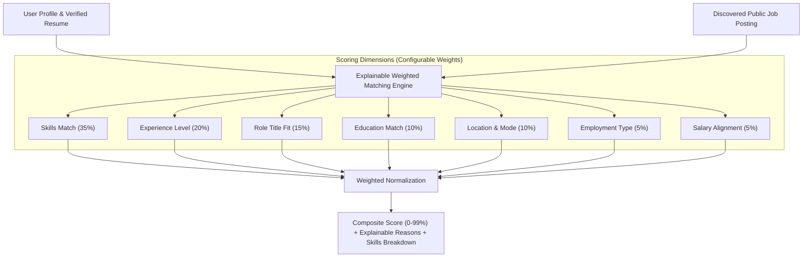
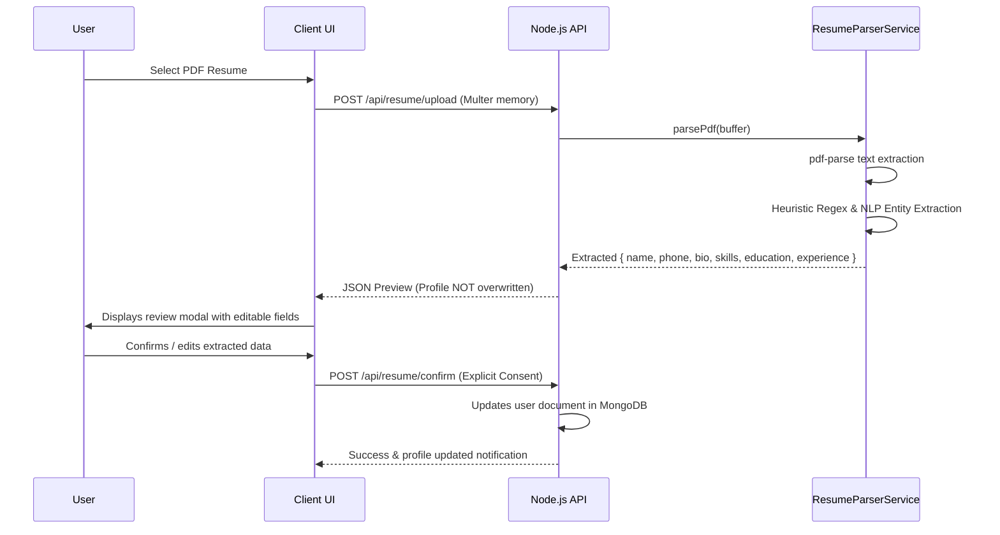

# JobPilot AI - AI & Matching Engine Architecture

## 1. Zero-Cost, Browser-Native Inference

JobPilot AI enforces strict zero-cost operation by avoiding proprietary, paid LLM APIs (OpenAI, Gemini, Claude).

Instead, AI semantic matching runs locally inside the user's web browser using `@xenova/transformers` with ONNX runtime acceleration and quantised sentence-transformer models (`Xenova/all-MiniLM-L6-v2`).

---

## 2. Explainable Weighted Scoring Formula

The matching engine computes a composite score:

$$\text{Composite Score} = \frac{\sum_{i} W_i \cdot S_i}{\sum_{i} W_i} \times 100$$

Where $W_i$ is the weight of dimension $i$ and $S_i \in [0, 1]$ is the dimension score.

### Default Dimension Weights:
1. **Technical Skills ($W_1 = 0.35$)**:
   - Compares the intersection between user verified skills and job required/extracted skills.
   - Outputs: Matched skills list, Missing skills list.
   - If employer does not list explicit tags, the engine scans the job description text for user skill occurrences.

2. **Experience & Seniority ($W_2 = 0.20$)**:
   - Assesses user career entry count and total years against role seniority (`entry`, `mid`, `senior`, `lead`).
   - Senior roles require $\ge 3$ recorded positions for optimal score ($\ge 0.95$).

3. **Job Title Fit ($W_3 = 0.15$)**:
   - Evaluates token overlap, Jaccard similarity, and substring containment between user preferred titles and posting title.

4. **Education ($W_4 = 0.10$)**:
   - Checks presence of relevant degrees (e.g. Bachelor's, Master's, Doctorate) in aligned disciplines (Computer Science, Engineering, etc.).

5. **Location & Work Mode ($W_5 = 0.10$)**:
   - 100% compatibility if user preferred mode matches job mode (e.g. Remote to Remote).
   - Country matching provides fallback alignment for regional onsite/hybrid jobs.

6. **Employment Type ($W_6 = 0.05$)**:
   - Compares user preferred commitment (`full-time`, `contract`, `part-time`) to job commitment.

7. **Salary Compatibility ($W_7 = 0.05$)**:
   - If salary bounds are published, evaluates whether job max salary meets user minimum expectation.
   - If salary is undisclosed by employer, assigns a neutral 70% score with clear explanation.

---

## 3. Resume Intelligence Pipeline

---

## 4. Fallback Architecture

If a client device has WebAssembly or WebGL disabled, or if the user explicitly turns off neural inference in **Settings**:
- The engine seamlessly falls back to high-speed token Jaccard similarity and boundary regex skill extraction.
- Scoring accuracy remains explainable and consistent.
- Zero server crashes or performance penalties.
